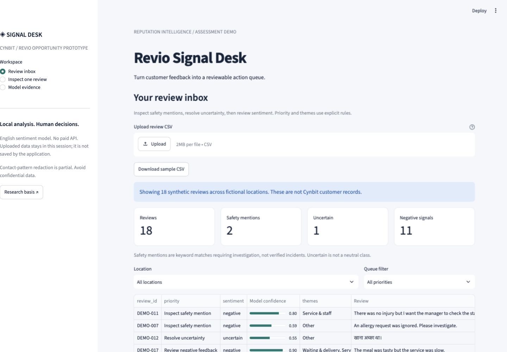
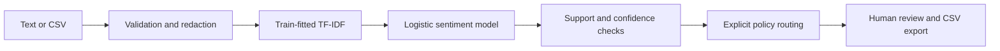

# Revio Signal Desk

**Identify an AI Opportunity for Cynbit — AI/ML Engineer Internship Assessment**

A working, local review triage prototype motivated by [Cynbit's Revio product](https://www.cynbit.in/products). It learns sentiment from an attributed public corpus, flags uncertainty, explains influential words and builds a human-reviewed queue. Company research and a weighted comparison of six opportunities preceded implementation.

This is an independent assessment concept. Revio already advertises sentiment and crisis features; the proposed incremental focus is explainability and uncertainty. Whether this fills an actual product gap requires discovery with Cynbit.



## What works

- Single-review and CSV inference with a real TF-IDF/logistic regression model.
- Input validation, partial contact redaction, unsupported-input abstention and clear errors.
- Explicit safety/theme rules, priority reasons, branch summaries and exact feature contributions.
- Location/priority filters and formula-safe CSV downloads.
- Measured baselines, test errors, domain-transfer experiment and 26 automated tests.
- Offline runtime with no paid APIs or secret keys.

Safety/theme rules are not learned classifiers. The sample's 18 reviews, dates and locations are fictional and clearly labelled. No customer action or public reply is automated.

## Run

Use Python 3.12. Verified on Python 3.12.14, macOS ARM64, including a fresh isolated installation.

```bash
git clone https://github.com/Sanskar1314/CynbitTask.git
cd CynbitTask
python3.12 -m venv .venv
source .venv/bin/activate
python -m pip install -r requirements.txt
python -m pytest -q
python scripts/evaluate.py
python -m streamlit run app/app.py --server.address 127.0.0.1 --server.port 8501
```

Open http://127.0.0.1:8501 . Public training data is bundled; model fitting is local and cached per process. No downloaded model weights are necessary. The optional Docker recipe has not been executed and is not claimed as verified.

In the prepared workspace:

```bash
cd /Users/sanskar/Desktop/InternshipTask
.venv/bin/python -m streamlit run app/app.py --server.address 127.0.0.1 --server.port 8501
```

Use the sample inbox or enter `Terrible food and rude service.`. Expected: negative suggestion, roughly 0.744 model confidence, with visible negative contributions from `terrible` and `rude`. Try Hindi, mixed sentiment and `There was no injury` to understand limitations.

CSV header: `review_id,text,location,date`. Dates must be real `YYYY-MM-DD` dates. Limit: 2 MB, 1,000 rows, 5,000 characters per review. The whole upload fails clearly when invalid. IDs must remain unique after contact redaction.

## Architecture



Python, scikit-learn, pandas, NumPy and Streamlit provide a small CPU-only stack. No LLM, prompt pipeline, RAG store or external runtime API is needed.

## Actual evaluation

UCI Sentiment Labelled Sentences: 3,000 raw rows; 2,979 after exact normalized deduplication. Seed 42; 1,787 train / 596 validation / 596 test. Vocabulary fitted only on train. C=4 and threshold=0.55 selected on validation.

| Model | Test macro-F1 | Accuracy | Negative recall | Brier score |
|---|---:|---:|---:|---:|
| Logistic regression | 0.7919 | 0.7919 | 0.7886 | 0.1384 |
| TF-IDF Naive Bayes | 0.8037 | 0.8037 | 0.8054 | 0.1504 |
| Majority | 0.3333 | 0.5000 | 1.0000 | 0.2500 |

**Important result:** Naive Bayes has slightly better F1; logistic has lower probability error. Accepted predictions: **82.52% accuracy at 89.26% coverage**, missing the 85% validation target. No test-driven retuning was performed. Unseen-Yelp stress test: macro-F1 **0.7664**. Bootstrap F1 interval: **0.7567–0.8222** (conditional on this fitted model).

Full evidence: [metrics](evaluation/metrics.json), [errors](evaluation/errors.csv), [test report](evaluation/Test_Report.md), [split manifest](evaluation/split_manifest.csv), [model card](docs/Model_Card.md).

## Deliverables

| Deliverable | Files |
|---|---|
| AI Opportunity Report | [Markdown](reports/AI_Opportunity_Report.md) · [PDF](reports/AI_Opportunity_Report.pdf) |
| Functional proof of concept | [UI](app/app.py) · [model](src/model.py) · [service](src/service.py) |
| Technical Approach Report | [Markdown](reports/Technical_Approach_Report.md) · [PDF](reports/Technical_Approach_Report.pdf) |
| Complete Project Explanation | [Markdown](reports/Complete_Project_Explanation.md) · [PDF](reports/Complete_Project_Explanation.pdf) |
| Company and industry research | [Company](docs/01_Company_Research.md) · [Industry](docs/02_Industry_Analysis.md) |
| Opportunity scoring | [Six candidates and sensitivity analysis](docs/03_Opportunity_Selection.md) |
| Learning resources | [Decision log](docs/Engineering_Decision_Log.md) · [Walkthrough](docs/Project_Walkthrough.md) |
| Interview preparation | [30 Q&A and pitches](docs/Interview_Preparation.md) · [Demo](docs/Demo_Walkthrough.md) |
| Diagrams | [Mermaid and rendered assets](assets/diagrams/) |
| Recovery and verification | [Project state](docs/PROJECT_STATE.md) · [Acceptance checklist](docs/Acceptance_Checklist.md) |

## Reproduce reports and data checks

```bash
python scripts/check_manifest.py
python -m pip install -r requirements-reports.txt
python scripts/build_pdfs.py
```

PDF generation reads complete Markdown originals and renders diagrams locally. ReportLab creates PDFs, pypdf checks extracted text, and pypdfium2 renders review images. Intermediate contact sheets are ignored under tmp/pdfs. If data/raw is missing, `python scripts/download_data.py` restores the three UCI files with network access. [Dataset attribution and limitations](data/DATA_CARD.md).

## Limits and deployment boundaries

Binary English sentence sentiment is not a neutral/multilingual model. Sarcasm, spelling variation and implied meaning fail. Script checks are heuristic. Contact redaction is not anonymization. Safety keywords can flag negated incidents. Exact deduplication cannot rule out hidden author/business grouping. Theme labels do not imply aspect-level sentiment.

No target-customer evaluation, measured ROI, authenticated Revio connector, persistent correction workflow or production deployment exists. The recommended next step is permissioned multilingual data and a controlled operator pilot. Uploaded data is not persisted by the application, but remains visible in browser/session memory during use. Do not upload confidential data to this local assessment demo.

## Development and deadline

Existing designated repository reused: https://github.com/Sanskar1314/CynbitTask . It was already public at inspection; visibility was not changed. Meaningful milestone commits and pushes are recorded in [Development Log](docs/Development_Log.md). The pre-existing .DS_Store modification is unrelated and was left untouched.

Supplied deadline: Sunday 18 October 2026, 03:48 AM. Timezone was not supplied or independently established. Asia/Kolkata is a planning assumption (17 October, 22:18 UTC), not a verified recruiter instruction. No assessment has been submitted or emailed.
