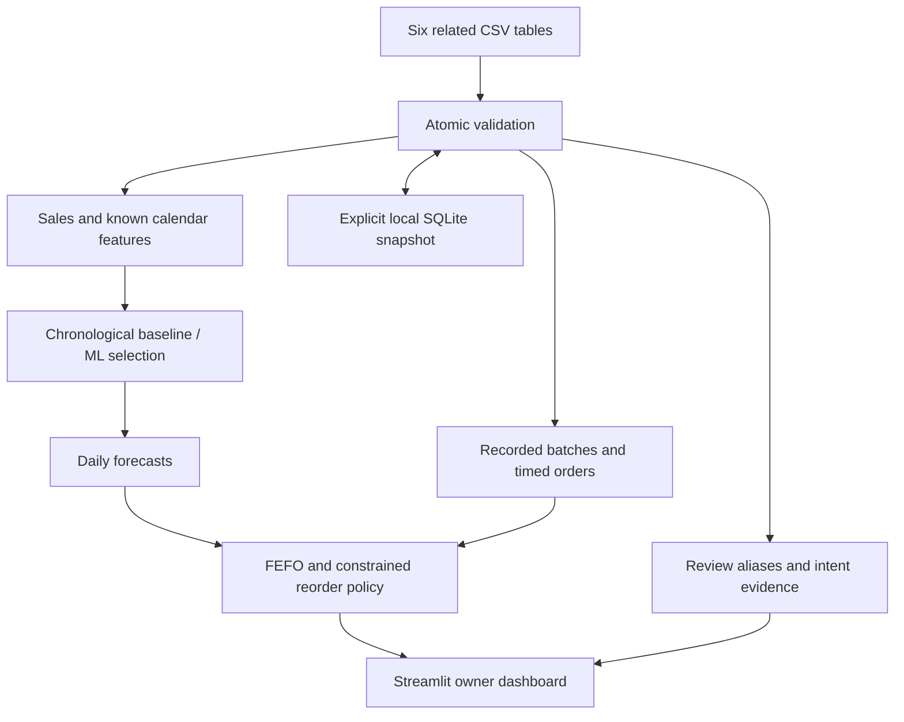

# Revio StockSense

**Demand forecasts and explainable inventory decisions for a kirana owner.**

StockSense helps review what to reorder, what is overstocked, which batches may expire and which products customers request. It is an independent assessment proposal for an optional Revio-adjacent module, not an existing Cynbit product or supported integration.

**All bundled data is synthetic. Festival dates are illustrative scenarios, not verified religious calendar dates. No orders are placed and no real-store ROI is claimed.**

## Run locally

Tested with Python 3.12. From a fresh clone:

```bash
git clone https://github.com/Sanskar1314/CynbitTask.git
cd CynbitTask
python3.12 -m venv .venv
source .venv/bin/activate
python -m pip install -r requirements.txt
OPENBLAS_NUM_THREADS=1 OMP_NUM_THREADS=1 python -m streamlit run app/app.py --server.address 127.0.0.1 --server.port 8501 --server.headless true --theme.base light
```

Existing workspace:

```bash
cd /Users/sanskar/Desktop/InternshipTask
OPENBLAS_NUM_THREADS=1 OMP_NUM_THREADS=1 .venv/bin/python -m streamlit run app/app.py --server.address 127.0.0.1 --server.port 8501 --server.headless true --theme.base light
```

Open [StockSense locally](http://127.0.0.1:8501/). This link works on the computer running the server; no public deployment was created. If port8501 is occupied by the previous prototype, stop that server first. A fresh server clears stale Python imports after replacing the old project.

## What works

- Eight sections: executive dashboard, product forecasts, reorder planner, seasonal/festival evidence, expiry, slow movers, reviews and data management.
- Actual sales/revenue/history summaries with known stockout days masked for demand learning.
- Global direct gradient boosting compared against28-day average and weekly seasonal naive forecasts.
- Chronological validation, held-out test metrics and7/14/30-day forecasts; no exact forecast for unsupported new products.
- Periodic-review quantities, timed confirmed orders, FEFO batch simulation, backorders and conservative receipt-life/storage/pack/MOQ constraints.
- Recorded manufacturing/expiry fields, expired/unknown warnings and estimated unsold-at-expiry. No invented expiry dates.
- English product/intent rules for requests, availability, variants and quality; no automatic numerical review uplift.
- Atomic six-CSV snapshot replacement, schema feedback, CSV downloads and explicit local SQLite save/load.

## Architecture and stack



Python, pandas, NumPy, scikit-learn, Streamlit, Plotly, SQLite, pytest and ReportLab. No paid API or language-model key is required. Modules are separated under src/; the UI lives in app/app.py.

## Measured forecasting results

Three chronological30-day validation folds select HistGradientBoosting by pooled MAE. The final test spans2026-09-17 through2026-10-16. Results below are **synthetic, uncensored observed product-days**, not real merchant performance.

| Method | Validation MAE | Test MAE | Test RMSE | Test WAPE | Test bias |
|---|---:|---:|---:|---:|---:|
| HistGradientBoosting | 3.101 | 2.975 | 4.064 | 22.248% | -0.163 |
| Moving average28d | 3.639 | 3.599 | 4.856 | 26.909% | +0.516 |
| Weekly seasonal naive | 4.435 | 4.094 | 5.456 | 30.613% | -0.181 |

Test count:353 supported product-days; seven censored stocked-product days excluded. Separate latent-demand simulation diagnostic covers360 days (boosting MAE2.979). No-history SKU has no target. WAPE is not classification accuracy. Full evidence: [metrics](evaluation/metrics.json), [product-day predictions](evaluation/backtest_predictions.csv).

```bash
OPENBLAS_NUM_THREADS=1 OMP_NUM_THREADS=1 .venv/bin/python -m pytest -q
OPENBLAS_NUM_THREADS=1 OMP_NUM_THREADS=1 .venv/bin/python scripts/evaluate.py
```

The suite includes data/persistence checks, business examples, causality, no-history, stockouts, expiry, receipt timing, constraints, reviews/events and navigation through every dashboard section. Rerun evaluation after model changes.

## Dataset and decisions

Seed42 creates1,020 daily observations per stocked SKU,12,240 sales rows,13 catalog products,24 batches,3 purchase orders,14 reviews and28 scenario calendar entries. Generate again with `python scripts/generate_data.py`. These are not Cynbit records. [Data card](docs/Data_Card.md) explains fields and assumptions.

Protection = lead time + review period. Target = cumulative demand + safety buffer. Raw need accounts for eligible inventory, timed receipts, expiry loss and backorders; safe caps and pack/MOQ rules produce the draft. Example:20/day x11 days +30 safety -80 stock -20 incoming =150. The dashboard explains any constraint that reduces this quantity. Unknown expiry or insufficient planning horizon can withhold it.

## Five-minute demo

1. Start at Executive Dashboard and state the synthetic-data boundary.
2. Forecast Cola for7/14/30 days; explain actual versus dashed future values and baseline comparison.
3. Inspect its reorder explanation and adjustable review/safety policy.
4. Show yogurt expiry risk, expired coffee, unknown chips expiry and biscuits overstock.
5. Show sugar-free requests and explain why a new SKU gets no invented exact order.
6. Inspect templates in Data Management and demonstrate incomplete-upload rejection.

## Documentation and assessment package

- [AI Opportunity Report](reports/AI_Opportunity_Report.md) / [PDF](reports/AI_Opportunity_Report.pdf): verified research, six opportunities, business fit and pilot plan.
- [Technical Approach Report](reports/Technical_Approach_Report.md) / [PDF](reports/Technical_Approach_Report.pdf): architecture, model, evaluation and inventory mathematics.
- [Complete Project Explanation](reports/Complete_Project_Explanation.md) / [PDF](reports/Complete_Project_Explanation.pdf): walkthrough, decisions, worked examples and40 interview questions.
- [Company Research](docs/Company_Research.md), [Engineering Decisions](docs/Engineering_Decision_Log.md), [Walkthrough](docs/Project_Walkthrough.md), [Interview Preparation](docs/Interview_Preparation.md).
- [Project State](docs/PROJECT_STATE.md), [Execution Log](docs/Execution_Log.md), [Development Log](docs/Development_Log.md).

Recommended submission package: repository URL, opportunity PDF, technical PDF, complete explanation PDF, README demo instructions and evaluation artifacts. No assessment submission or recruiter communication has been performed.

Rebuild PDFs:

```bash
.venv/bin/python -m pip install -r requirements-reports.txt
.venv/bin/python scripts/build_reports.py
```

## Limits and production next steps

Single-store synthetic proof of concept; no authenticated public service, POS/Revio API, automatic purchasing, budget optimization, calibrated uncertainty or verified ROI. Missing availability creates unidentified lost demand. Masking stockouts can still bias learning. Event evidence is descriptive, calendar dates need regional verification, and English review rules can fail on sarcasm or mixed-product language. Pooled model selection can conceal SKU-specific weaknesses. Receipt shelf life is assumed until supplier labels are known. Thirty-day forecasts cannot fully assess later expiry or longer protection.

Before production: confirm Cynbit feature overlap and supported integration, obtain consented real records, reconcile stock, run shadow-policy evaluation, add tenant isolation/auditability and monitor SKU errors and real inventory costs. The original prototype remains recoverable at Git commit14df7c7b28cdee253171e5a78c663656bab5d557. Existing Git history and unrelated user files were preserved.
