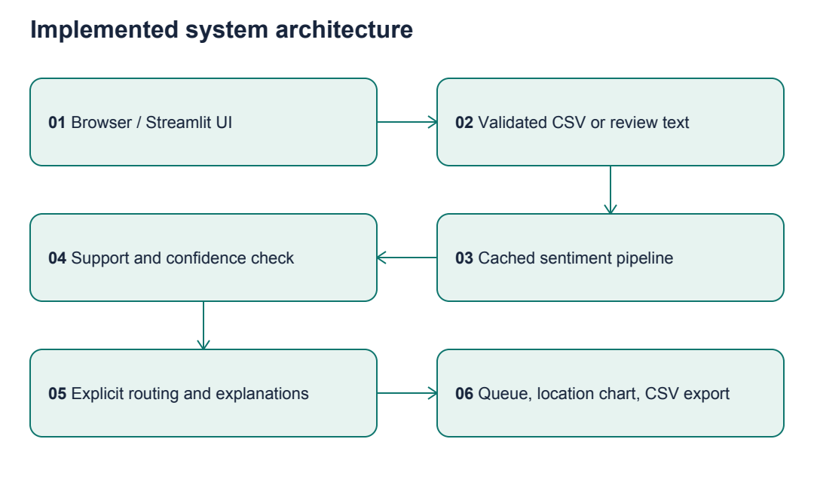

# Complete Project Walkthrough

## Start with the business question

Cynbit advertises Revio as a reputation-management product. This project asks whether a reviewable queue can help an operator decide what to inspect. It does not establish that Revio lacks such a feature. Company research and a six-opportunity comparison preceded implementation. Read docs/03_Opportunity_Selection.md to understand why this was selected over property reconciliation, learning recommendations, discovery matching, support retrieval and cloud anomalies.

## Architecture in plain English

A browser shows a Streamlit application running on your laptop. A review passes through validation and normalization. A trained text model estimates sentiment. A separate policy checks uncertainty and keyword mentions. The UI displays a queue and explanations; the operator remains responsible for decisions.



A sparse vector stores mostly zeros: a short review uses only a few words from the vocabulary. TF-IDF gives weight to words based on their frequency in a document and rarity across training documents. An n-gram is a sequence of words; a bigram has two adjacent words. Logistic regression learns how those weighted features relate to positive and negative labels.

## Directory map and important files

| Path | Purpose |
|---|---|
| app/app.py | UI, navigation, loading/errors, filters, exports and model evidence |
| src/data.py | Corpus loading, normalization, CSV validation and safe export |
| src/model.py | Pipeline creation, validation selection, probabilities and explanations |
| src/service.py | Sentiment-to-queue routing and location summaries |
| scripts/download_data.py | Optional reproducible public corpus download and hash manifest |
| scripts/evaluate.py | Splits, baselines, metrics, error files and timing |
| scripts/build_pdfs.py | Reproducible reports and vector architecture diagrams |
| data/raw/ | Attributed public benchmark text |
| data/sample/reviews.csv | Fictional demonstration inputs |
| tests/ | Core and Streamlit integration checks |
| evaluation/ | Actual measured results and verification evidence |
| reports/ | Mandatory Markdown reports and generated PDFs |
| docs/ | Research, decision log, walkthrough, interview and recovery state |
| assets/diagrams/ | Mermaid sources and rendered diagrams |

## How training works

1. load_benchmark reads three public files, joining the two multiline IMDb examples correctly.
2. normalize canonicalizes whitespace/Unicode, lowercases and redacts common contacts.
3. Hashes identify duplicate canonical text. Keep 2,979 of 3,000 records.
4. split_benchmark creates fixed 1,787 training, 596 validation and 596 test rows.
5. make_model builds TF-IDF plus logistic regression. fit learns vocabulary/IDF and coefficients using only training rows.
6. train_engine compares C values on validation F1, chooses C=4, then selects threshold 0.55 on validation accuracy/coverage.
7. The app uses the same fitted model, cached in memory. It does not fit on uploaded reviews or update from the test set.

C controls inverse regularization strength: larger C allows less penalty on large coefficients. Here it is selected empirically within a small predeclared grid. A vocabulary learned on test text would leak information about the evaluation distribution, so the Pipeline fits it only on training text.

## Key inference functions

validate_text checks string type, content and length. read_reviews validates the complete CSV, including uniqueness and calendar dates. probabilities uses the fitted pipeline to estimate positive probability. supported checks script proportion and recognized vocabulary. explain computes each observed feature's contribution. analyze_review combines model output with policy. analyze_batch preserves metadata and sorts rows. location_summary counts reviews, accepted negatives, uncertain items and safety mentions per branch.

## Worked example

Input: 'Terrible food and rude service.'

The runtime normalizes it, maps words/pairs into the fitted vocabulary, and returns a positive probability of approximately 0.256. Negative probability is approximately 0.744, above the selected confidence threshold. It suggests negative sentiment and the negative-feedback queue. Service/staff and quality are keyword themes. The terms 'terrible' and 'rude' contribute negatively to positive log-odds. Other terms can have surprising weights; these are learned correlations, not causal reasons.

For the full logit z, sum all feature contributions and the intercept b. Apply the sigmoid to get p. tests/test_pipeline.py verifies that this reconstructed probability matches the model output. Displaying only the largest eight contributions is a readable partial explanation; the full sum is used in the test.

## Examples that reveal limits

- Hindi text in the sample is uncertain because the English-script guard fails.
- 'There was no injury' still produces a safety mention. The rule is intentionally literal and requires human context review.
- 'It was okay I suppose' can receive a negative prediction because neutral is not a trained class.
- Mixed praise and criticism can produce one coarse sentence-level label; keyword themes do not provide per-aspect sentiment.
- An unseen word has no learned feature. A completely empty vector is routed to uncertainty.

## Application flow

Open Review inbox: the labelled synthetic sample loads. Upload replaces it for the current session after validation. Inspect summary cards, select a location/priority, review the reason column and export filtered results. The location chart always summarizes the entire upload and its counts can overlap. Expand the evidence panel to inspect an individual review.

Open Inspect one review: edit text and press Analyze review. Empty input gives a visible error. Model evidence displays test baselines and validation threshold tradeoffs. Confidence is a model estimate; 'accepted' only means the model suggestion passes a threshold, never permission for an automated external action.

## Installation and run commands

Use Python 3.12. From the repository root:

```bash
python3.12 -m venv .venv
source .venv/bin/activate
python -m pip install -r requirements.txt
python -m pytest -q
python scripts/evaluate.py
python -m streamlit run app/app.py --server.address 127.0.0.1 --server.port 8501
```

Then open http://127.0.0.1:8501 . In the existing prepared workspace, .venv/bin/python is already available; do not recreate it merely to run the demo.

```bash
.venv/bin/python -m streamlit run app/app.py --server.address 127.0.0.1 --server.port 8501
```

The corpus is included. If it is missing, run python scripts/download_data.py with internet access. No API key is needed. To regenerate PDFs, install requirements-reports.txt and run python scripts/build_pdfs.py.

## Evaluation explained

Accuracy is the fraction correct. Macro-F1 averages the positive and negative class F1 values equally. Negative recall answers: of true negative examples, how many did the classifier catch? Brier score measures squared probability error; lower is better. Coverage is the fraction receiving a confident supported suggestion. Selective accuracy is accuracy only within that accepted subset; it must always be reported alongside coverage.

Actual test results: 0.7919 macro-F1, 0.7886 negative recall, 0.1384 Brier. NB macro-F1 is 0.8037. Confidence filtering retains 532/596 rows at 0.8252 accuracy. Do not quote 86.8% validation selective accuracy as the final test result. Domain shift to unseen Yelp gives 0.7664 macro-F1 in a separate experiment. No customer ROI was measured.

Read evaluation/errors.csv for actual mistakes. Each row contains a source ID, true label, prediction, probability and acceptance flag. Use errors to propose improvements, then reserve a new test set before testing those improvements. Repeatedly tuning against this test set would turn it into validation data.

## Common errors and fixes

| Symptom | Likely cause | Fix |
|---|---|---|
| streamlit or sklearn missing | Wrong interpreter | Activate .venv; install requirements |
| Dataset missing | Raw files omitted | Restore tracked files or run download script |
| CSV requires columns | Wrong header names | Use the downloadable sample schema |
| Invalid calendar date | Impossible or non-ISO date | Use YYYY-MM-DD with a real date |
| Duplicate review_id | Ambiguous row identity | Assign unique non-personal IDs |
| Unexpected uncertain | Low confidence/unsupported vocabulary or script | Human review; do not force a label |
| Address already in use | Port 8501 occupied | Reuse running server or choose --server.port 8502 |
| Local socket permission error | Managed execution sandbox | Use approved localhost execution; do not disable system controls |

## What is implemented versus proposed

Implemented: offline corpus, supervised classifier, explainable inference, validation, abstention, policy queue, UI, export, evaluation and local testing. Proposed: production API, customer authentication, multilingual model, operator feedback storage, learned urgency and external platform connectors. The demo never posts replies, sends email or changes customer systems.
