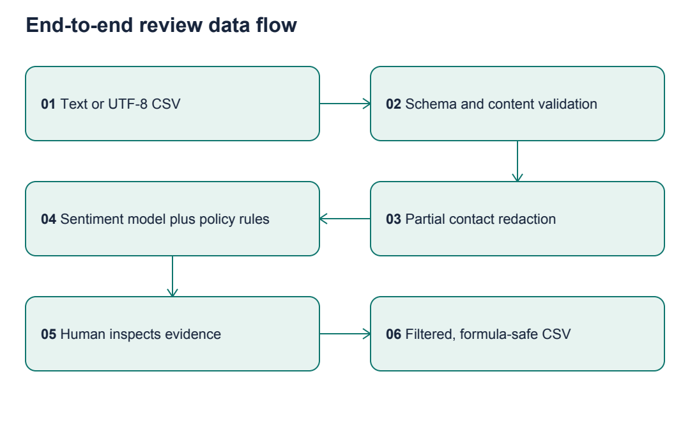

# AI Opportunity Report
## Identify an AI Opportunity for Cynbit

Revio Signal Desk | AI/ML Engineer Internship Assessment | 16 October 2026

## 1. Executive Summary

Recommend a limited discovery and supervised pilot of Revio Signal Desk, an explainable review triage workbench. It combines learned sentiment with uncertainty routing, visible word contributions and explicit policy flags. The working prototype runs locally without paid APIs. It is an independent assessment concept, not an official Cynbit product or deployed Revio integration.

Six opportunities were compared. Review triage scores 4.50/5 under the assessment constraints. The recommendation depends on confirming a real workflow gap: Cynbit already advertises sentiment and crisis features. The prototype's incremental emphasis is auditability and uncertainty, not a claim to have invented reputation AI.

The experiment also establishes a limit: held-out sentiment macro-F1 is 0.792, below a Naive Bayes baseline's 0.804. Confidence filtering yields 82.5% accepted accuracy at 89.3% coverage, missing the 85% validation target. This supports a human-reviewed experiment, not autonomous customer-facing decisions.

## 2. Introduction to Cynbit

Cynbit is the Jaipur-based technology company associated with cynbit.in, independently located through web search and cross-checked against its LinkedIn company profile. The researched business surface combines software services, a product portfolio and technical education. Detailed evidence follows; internal performance and commercial scale are unknown.

## 3. Verified Company Research

The LinkedIn company profile links to cynbit.in and identifies Cynbit Technologies in Jaipur. The official site uses the same name and location; its careers page lists AI/ML Engineer Intern. This combination distinguishes Cynbit from Cybit (cybit.com and cybit.in) and Cybint. LinkedIn is corroboration of identity, not independent validation of product performance.

| Finding | Evidence | Source URL | Confidence |
|---|---|---|---|
| Official domain and Jaipur identity | Matching company name, location and website link | https://in.linkedin.com/company/cynbit-in | High for identity |
| Software and AI services | Website offers agents, document automation, web/mobile development, cloud services and marketing | https://www.cynbit.in/services | High that these are advertised; delivery unverified |
| Three named products | Cynbit Studio, TenantEase and Revio appear in product suite | https://www.cynbit.in/products | High for advertised offerings |
| Existing AI positioning | Revio advertises sentiment, review responses and crisis detection; Studio advertises AI learning support | https://www.cynbit.in/products | High for claims; maturity unknown |
| Property operations | TenantEase describes rent, tenant, unit and occupancy management | https://www.cynbit.in/products | High for positioning |
| Company origin | Story describes a 2024 official launch after earlier preparation | https://www.cynbit.in/story | Medium; company narrative |
| Education offering | BitElevate presents technical training and project experience | https://www.cynbit.in/bitelevate | High for offering; outcomes unverified |
| Discovery workflow | Contact page requests project requirements and offers discovery calls | https://www.cynbit.in/contact | High |
| Assessment role aligns | AI/ML internship appears in careers | https://www.cynbit.in/careers | High; private deadline not published |
| Industry breadth | Case-study index includes education, retail, health, events and enterprise software | https://www.cynbit.in/case-studies | Medium; self-published portfolio |
| Technical content | Blog covers automation, marketing, customer support and cloud | https://www.cynbit.in/blog | High for published topics |

## Coverage and evidence boundaries

Inspected homepage, story/about, services, products, contact, careers, BitElevate, blog index, case-study index, the EContentPrep adaptive-learning case study, and the small-business automation article. Related pages:
- https://www.cynbit.in/
- https://www.cynbit.in/case-studies/econtentprep-adaptive-learning
- https://www.cynbit.in/blog/small-business-ai-automation

No public API specification, internal review corpus, pricing contract, deployment telemetry or audited customer outcomes were found in the inspected material. No separate industry or documentation portal was established. Named case studies indicate marketed sectors, not independently confirmed client relationships. Website performance counters are marketing claims and are excluded from business forecasts.

The likely business model combines custom services, SaaS products and training (inference from the offering structure). Target users inferred for the proposed prototype are Revio brand managers and location operators. Their actual workflow, review volumes and purchase willingness remain discovery questions.

## Access policy

robots.txt retrieved through a direct public request: Allow /; Crawl-delay 1; disallow /api/, /admin/, /portal/. Only public content was inspected; no restricted endpoints or logins were accessed. No bulk website scraping was used.

## 4. Industry Overview

Birdeye advertises feedback aggregation, location-level priorities and action tracking. Podium advertises AI review responses and review collection. These vendor descriptions establish competing capabilities, not independent proof of effectiveness. Generic sentiment and reply generation therefore offer weak differentiation. Cynbit would need workflow fit, dependable evaluations, pricing and integration advantages rather than a novelty claim.

- https://birdeye.com/insights-ai/
- https://www.podium.com/product/reviews

Google Business Profile documents review retrieval and reply management using authorized account/location resources. A production integration requires legitimate access and appropriate permissions; public visibility of a review is not permission to bypass the API. The prototype uses local CSV input and performs no review posting.

- https://developers.google.com/my-business/content/review-data

## 5. Major Industry Challenges

1. Fragmented feedback: Revio's multi-location positioning makes a single review queue plausible. Actual fragmentation at Cynbit customers is a hypothesis to validate.
2. Limited attention: negative sentiment alone does not identify which item a manager should inspect first. Uncertain classification and explicit safety terms deserve visible reasons.
3. Weak ground truth: review labels, languages and sectors differ. A public dataset can test engineering mechanics but cannot establish target-customer accuracy.
4. Integration cost: platform authorization, quotas, retries and duplicate ingestion can dominate model cost. Start with CSV before investing in connectors.
5. Trust and accountability: an erroneous public reply can damage customer relationships. This experiment supports internal review; response generation is outside scope.
6. Product breadth: services, education and property management create other opportunities, but outcome-labelled internal data is not publicly available.

## 6. AI/ML Opportunity Landscape

Opportunities fall into feedback operations, finance operations, learning personalization, requirements discovery, support knowledge and infrastructure monitoring. Their shared constraint is reliable ground truth. A useful assessment should demonstrate the engineering loop from evidence to evaluation while acknowledging that public data is a proxy.

## 7. Identified AI Opportunities

### A. Revio Signal Desk: explainable review triage
Business problem: managers need a defensible queue for inspecting feedback. Relevance/evidence: Revio's advertised review intelligence and multi-location workflow. Approach: supervised text sentiment, confidence-based abstention, transparent policy flags and branch/theme summaries. Users: brand and location managers. Data: licensed sentiment corpus for mechanics; permissioned reviews plus operator decisions for a pilot. Complexity: medium. Expected impact: less manual sorting, hypothesis only. Feasibility: high for a local demo, uncertain for production languages. Risks: sarcasm, domain shift, false urgency and incomplete redaction. Metrics: macro-F1, negative recall, coverage/selective accuracy, Brier score, review time and override rate. Scale: batched CPU inference and tenant-isolated queues. Existing sentiment/crisis features are acknowledged; the proposed incremental focus is uncertainty and auditable decision support, whose absence in Revio is not established.

### B. TenantEase rent reconciliation anomaly assistant
Problem: identify inconsistent payment records. Evidence: TenantEase describes rent and transaction tracking. Approach: reconciliation rules plus Isolation Forest on transaction features. Users: property operators. Data: ledger, invoices and verified exceptions, currently unavailable. Complexity: medium-high due to accounting integration. Impact: potentially faster exception handling; unmeasured. Feasibility: synthetic-only demonstration is easy but business validation weak. Risks: false accusations, irregular legitimate payments and personal financial data. Metrics: exception precision, recall and reconciliation time. Scale: per-property baselines with human approval; never automated tenant eligibility decisions.

### C. Cynbit Studio learning-gap recommender
Problem: choose useful next exercises. Evidence: Studio advertises adaptive learning. Approach: knowledge tracing or content-based recommendations. Users: learners and mentors. Data: consented attempts, skill rubric and longitudinal outcomes. Complexity: high. Impact: potentially better practice allocation. Feasibility: limited by unavailable interaction histories. Risks: reinforcing early mistakes, unfair difficulty and child-data handling. Metrics: learning gains in controlled studies, completion and recommendation coverage. Scale: curriculum versioning and cohort monitoring. Must extend rather than duplicate advertised adaptation.

### D. Services discovery and requirements matcher
Problem: structure incoming project briefs. Evidence: contact page describes requirement analysis. Approach: retrieval over approved service descriptions and missing-requirement extraction. Users: solution architects. Data: public service corpus plus labelled briefs. Complexity: low-medium. Impact: potentially faster intake; volume unknown. Feasibility: high. Risks: unsupported promises, shallow retrieval, confidential briefs. Metrics: retrieval recall@k, missing-field accuracy and architect edit time. Scale: approved catalog versions and CRM integration.

### E. Support knowledge retrieval with citations
Problem: locate trustworthy product answers. Evidence: broad product/support surface; internal burden unverified. Approach: retrieval over manuals, with abstention and optional grounded generation. Users: support agents. Data: approved manuals, support questions and access rules; public corpus is thin. Complexity: medium. Impact: potentially shorter handling time. Feasibility: constrained by missing manuals. Risks: hallucinations and cross-tenant leakage. Metrics: retrieval recall, answer support and resolution time. Scale: tenant filters and document lifecycle controls.

### F. Cloud-service anomaly monitoring
Problem: surface service incidents. Evidence: cloud services and backend offerings. Approach: seasonal residuals and anomaly detection on telemetry. Users: operations engineers. Data: logs, metrics and incident labels, unavailable publicly. Complexity: high. Impact: potentially lower detection time. Feasibility: synthetic workloads only before access. Risks: alarm fatigue, changing baselines and missing context. Metrics: incident recall, false alerts/day and detection delay. Scale: streaming aggregation and service-specific thresholds.

## 8. Comparative Opportunity Matrix

1 = weak; 3 = moderate; 5 = strong. For complexity-related feasibility, higher is easier. Data availability measures usable assessment data, not access to company production data.

| Opportunity | Impact 25% | Relevance 25% | Feasibility 15% | Data 15% | Demo 10% | Scale 10% | Weighted /5 |
|---|---:|---:|---:|---:|---:|---:|---:|
| A Revio triage | 4 | 5 | 5 | 4 | 5 | 4 | 4.50 |
| B Reconciliation | 4 | 5 | 3 | 2 | 4 | 4 | 3.80 |
| C Learning gaps | 4 | 5 | 3 | 2 | 4 | 5 | 3.90 |
| D Discovery matcher | 3 | 4 | 5 | 4 | 4 | 4 | 3.90 |
| E Support retrieval | 4 | 4 | 4 | 2 | 4 | 4 | 3.70 |
| F Cloud anomalies | 4 | 4 | 3 | 2 | 4 | 4 | 3.55 |

Calculation: sum(score * weight); weights total 1.00.

## 9. Scoring Methodology

A: impact 4 because triage is a recurring task but volume unknown; relevance 5 from direct Revio fit; feasibility 5 from CPU classification; data 4 because public labels exist but target labels do not; demo 5 from interactive batch and single-review flow; scale 4 because inference is cheap but integrations need work.
B: impact 4 for costly bookkeeping exceptions; relevance 5 from TenantEase; feasibility 3 for accounting semantics; data 2 because real ledgers are absent; demo 4 for visible exceptions; scale 4 with per-property rules.
C: impact 4 for learning outcomes; relevance 5 from Studio; feasibility 3 because longitudinal evaluation is needed; data 2 for missing attempts; demo 4 for clear recommendations; scale 5 for reusable curricula.
D: impact 3 because inquiry volume is unknown; relevance 4 from discovery workflow; feasibility 5 for small-corpus retrieval; data 4 for public descriptions but no labelled briefs; demo 4 for evidence matching; scale 4 with catalog governance.
E: impact 4 for potential support workload; relevance 4 because support exists but pain is unverified; feasibility 4 for mature retrieval patterns; data 2 for missing manuals; demo 4 for cited answers; scale 4 with tenant isolation.
F: impact 4 for incident cost; relevance 4 from cloud services; feasibility 3 for seasonality and incident validation; data 2 for absent telemetry; demo 4 for time-series plots; scale 4 with operational investment.

## 10. Recommended Opportunity

Revio Signal Desk. Deliverable: a local application for entering or uploading reviews, inspecting sentiment evidence and uncertainty, filtering a branch queue and exporting a redacted result. Safety and topic rules remain visibly separate from the trained sentiment model.

## 11. Business Justification

A combines direct product adjacency, accessible licensed labels, measurable errors and a short path to a supervised pilot. It creates an opportunity to test reliability and operator usefulness before paying for broad integrations or generative automation. D is a strong fallback if Revio already has an equivalent triage workflow. B/C/F need private longitudinal data before credible evaluation. E lacks a useful public support corpus.

Sensitivity: lowering A's data score from 4 to 2 gives 4.20; lowering impact from 4 to 3 as well gives 3.95, narrowly above C/D at 3.90. If relevance also falls by one point after product discovery, A falls to 3.70 and D becomes preferable. The recommendation is conditional, not an assertion that Cynbit lacks the feature.

## 12. Proposed Solution

A manager loads a CSV or uses the synthetic demo, checks safety mentions, resolves uncertain items, then reviews negative feedback. Individual explanations reveal which words affected the score. Location summaries expose concentrations without claiming statistically significant incidents. The system provides no automatic replies and takes no action on external platforms.

The sentiment model is real supervised machine learning. Themes, safety terms and queue ordering are transparent rules, deliberately not presented as trained classifiers. The complete implementation and measured results are documented in the Technical Approach Report.

## 13. Expected Business Value

Hypothesis: structured triage could reduce sorting effort while making model mistakes easier to detect. No time saving, revenue gain or customer retention improvement has been measured. A pilot should compare time per correctly reviewed item and error rate against unassisted review.

Illustrative planning formula, not a result: monthly gross hours saved = review volume * minutes saved per review / 60. If a consenting pilot processes 1,000 reviews and saves 0.5 minute each, gross saving would be 8.3 hours before correction, integration and monitoring overhead. These inputs are hypothetical. Net benefit could be zero or negative if false alerts increase work.

## 14. Implementation Feasibility

The assessment implementation uses CPU-only scikit-learn, pandas and Streamlit. All source data is bundled with attribution; no model download or key is needed to run. A deployment pilot requires customer permission, appropriate platform integration, tenant isolation, real annotation and multilingual testing. Product discovery should determine whether an equivalent feature already exists before investment.

## 15. Risks and Limitations

Review text can contain names, contact details and sensitive experiences. The demo redacts common email and phone patterns, runs locally and does not persist uploaded data. This is partial minimization, not anonymization. Names, addresses and contextual identifiers can remain. For a pilot: define purpose, lawful processing, access controls, retention, deletion, vendor obligations and incident handling with qualified reviewers.

India's official data-protection materials must be checked for applicable provisions and phased commencement before deployment; this report does not assert blanket legal compliance. Source: https://www.meity.gov.in/documents/act-and-policies . NIST AI RMF provides a useful voluntary structure for mapping risks, measuring behavior and managing failures: https://www.nist.gov/itl/ai-risk-management-framework .

Technical limits include binary English labels, old curated sentences, incomplete PII redaction, false safety mentions, coarse keyword topics and no customer-specific evaluation. Competitors already advertise related functionality. No verified competitive moat or market sizing is claimed. Test performance below the validation target is a specific reason to retain human control.

## 16. Future Opportunities

After permissioned data collection: annotate aspect sentiment and urgency; evaluate multilingual models; measure calibration; add operator correction capture and tenant-aware ingestion. Revisit the discovery matcher if customer interviews invalidate the review workflow gap. Reconciliation and learning recommendations become stronger candidates once appropriate private data is available.

## 17. Conclusion

Cynbit should invest first in validating operator demand and reliability for an explainable Revio workflow. The assessment delivers a functioning testbed and an honest measurement baseline. It does not justify immediate autonomous deployment. A decision to expand should depend on a controlled pilot outperforming manual review on both effort and errors.

## 18. References

All accessed 2026-10-16. Company pages are first-party claims; vendor pages establish advertised features, not efficacy.

- Cynbit official website: https://www.cynbit.in/
- Identity corroboration: https://in.linkedin.com/company/cynbit-in
- Products: https://www.cynbit.in/products
- Services: https://www.cynbit.in/services
- Careers: https://www.cynbit.in/careers
- Story: https://www.cynbit.in/story
- Contact: https://www.cynbit.in/contact
- BitElevate: https://www.cynbit.in/bitelevate
- Portfolio: https://www.cynbit.in/case-studies
- Insights: https://www.cynbit.in/blog
- Birdeye: https://birdeye.com/insights-ai/
- Podium: https://www.podium.com/product/reviews
- Google review API: https://developers.google.com/my-business/content/review-data
- UCI dataset: https://doi.org/10.24432/C57604
- NIST AI RMF: https://www.nist.gov/itl/ai-risk-management-framework
- MeitY policy sources: https://www.meity.gov.in/documents/act-and-policies
