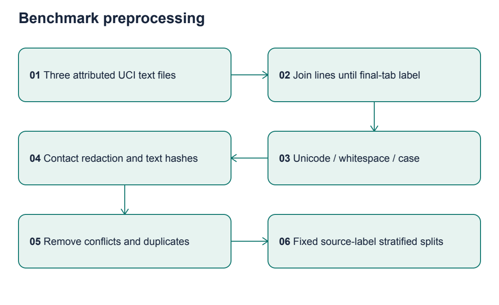
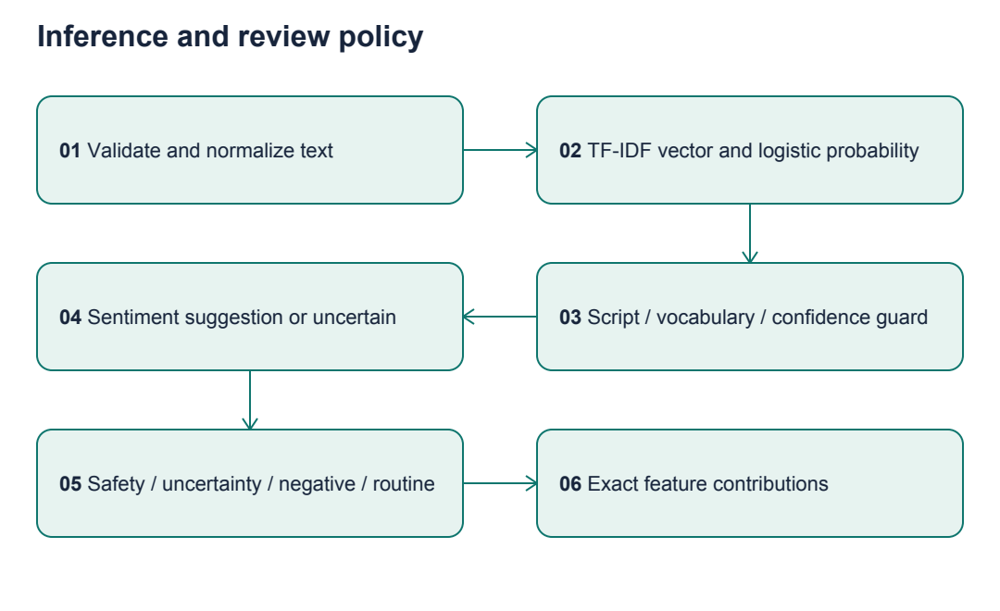
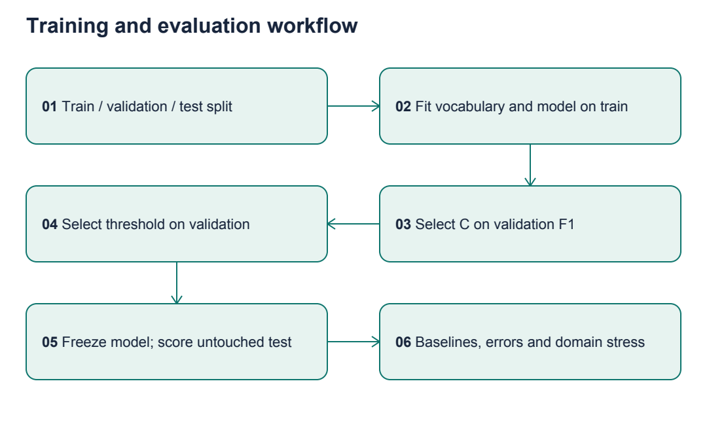
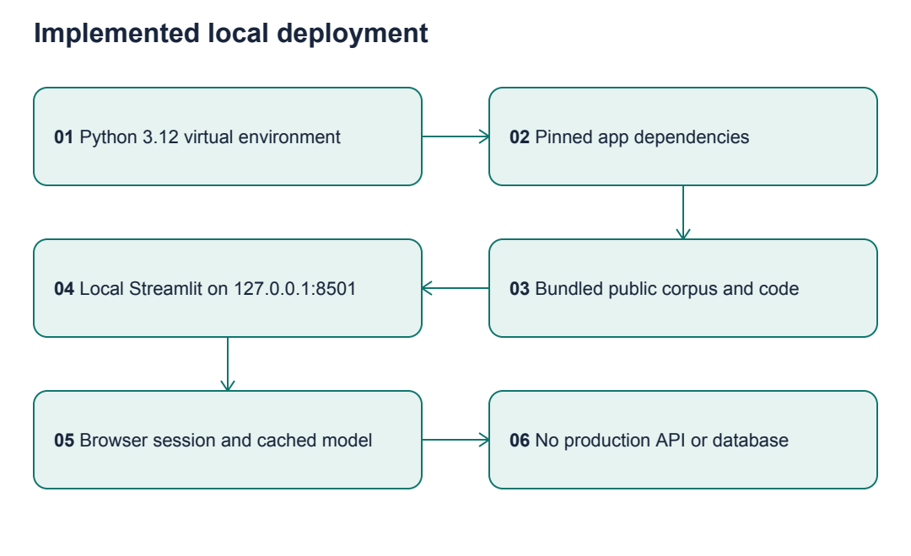

# Complete Project Explanation

Revio Signal Desk | Learning and interview companion | 16 October 2026


# Technical Approach Report
## Revio Signal Desk

Reproducible supervised NLP and human-reviewed routing | 16 October 2026

## 1. Problem Statement

Evaluate whether a compact, explainable sentiment service can support a Revio review triage workflow. Cynbit's product page motivates the adjacency; no access to its implementation, customers or internal review data was available. This project is an independent proof of concept.

## 2. Project Objectives

Deliver working input-to-output inference, reproducible comparisons, clear uncertainty handling and a demo that can be explained in an interview. Separate model decisions from policy rules. Establish evidence for a later pilot, without claiming production readiness.

## 3. Functional Requirements

- Accept individual text and UTF-8 CSV files with review_id, text, location and date.
- Validate fields, dates, row limits, duplicate IDs and text length; report actionable errors.
- Redact common contact patterns; infer binary sentiment and expose exact linear contributions.
- Abstain for insufficient confidence, unsupported script or zero recognized vocabulary.
- Assign explicit review priorities and keyword themes; summarize locations.
- Filter and export a queue; display model evidence and synthetic-data labels.

## 4. Nonfunctional Requirements

Local CPU execution with no API keys, bounded uploads (2 MB, 1,000 rows, 5,000 characters per review), train-only vocabulary fitting, deterministic seed, no application persistence of uploaded reviews and no external posting. Measured timing is reported below; it is not an SLA. The UI caches only the public-data-trained model across sessions.

## 5. Proposed AI/ML Solution

TF-IDF word unigrams and bigrams feed L2 logistic regression. Validation selects regularization from C in {0.25, 1, 4}. The selected C is 4.0. A 0.55 confidence threshold maximizes validation coverage among candidates meeting 85% accuracy and 30% coverage. Unsupported input always abstains. A failed threshold search would use 1.01 and abstain on every review.

## 6. System Architecture


The actual runtime is browser -> local Streamlit process -> shared validation -> cached sentiment pipeline -> policy routing -> table/chart/export. There is no database, background agent, LLM or external review API in the implemented path. Mermaid sources for all diagrams are in assets/diagrams.

## 7. Technology Stack

Python 3.12.14; scikit-learn 1.9.1; NumPy 2.3.5; pandas 2.2.3; SciPy 1.18.1; Streamlit 1.66.0; pytest 9.1.1. PDF generation uses ReportLab; text/visual verification uses pypdf and pypdfium2. Exact tested direct dependencies are pinned in requirements files. Transitive versions are recorded in evaluation/environment.txt; a fresh environment installation is the reproducibility check.

## 8. Technology Selection Rationale

scikit-learn provides transparent sparse linear models and shared Pipeline preprocessing. Streamlit delivers useful interaction with limited frontend complexity. pandas handles tabular ingestion and summaries. CPU training avoids paid services and large pretrained weights. Standard-library downloads and fixed archive filenames reduce dependencies. No orchestration framework is required for a deterministic single-process flow.

## 9. Dataset Description

UCI Sentiment Labelled Sentences (Kotzias, 2015; CC BY 4.0), originally 3,000 binary-labelled English sentences from Amazon, IMDb and Yelp. After canonical-text deduplication: 2,979 rows; 21 duplicate rows removed and no conflicting-label rows found. Training/validation/test sizes: 1,787/596/596. The independent 18-row synthetic demo contains fictional locations and dates and is excluded from accuracy measurement.

## 10. Data Collection

scripts/download_data.py fetches the public UCI archive with a timeout, reads only three allowlisted filenames and records SHA-256 hashes. Raw texts are bundled with attribution in data/DATA_CARD.md. No customer data was scraped, and no production connectors were used. Dataset provenance is in data/raw/manifest.json.

## 11. Data Preprocessing



The loader joins continuation lines until a final-tab label; this preserves two multiline IMDb records. Punctuation-only labelled sentences remain in the benchmark even though new UI inputs must contain letters. Normalize Unicode NFKC, apostrophes, whitespace and lowercase; redact common email/phone patterns. Retain stop words to preserve negation. Hash canonical text globally, exclude conflicting duplicates, then keep one exact duplicate. Split by source+label with seed 42. Fit vocabulary and IDF only on training rows.

Original review-author and business IDs are absent, so group-level and near-duplicate leakage cannot be excluded. Global exact deduplication before splitting is a defensive control, not a complete guarantee.

## 12. Model Selection

No pretrained model or fine-tuning is required. Logistic regression provides a compact classifier with directly inspectable weights and probability outputs. Validation macro-F1 for C=0.25/1/4 was 0.7970/0.8205/0.8272. L2 regularization, limited feature count (20,000), min_df=2 and held-out validation constrain overfitting. The model is not refitted on validation after selection, preserving the threshold's relationship to its fitted weights.

## 13. Alternative Approaches

A majority baseline establishes class-prior performance. Multinomial Naive Bayes with matching TF-IDF preprocessing is a meaningful cheap text baseline. Its held-out macro-F1 is slightly better; this is reported without changing the test-selected story. Logistic regression remains the preselected prototype model because of probability behavior and exact linear explanations, not superior test F1. A new comparison of calibrated Naive Bayes would require a fresh validation protocol and another untouched test set.

A transformer might improve contextual understanding but adds model downloads and computational complexity without target-domain labels. An LLM adds cost, nondeterminism and potential unsupported output. Keyword-only sentiment cannot learn weighted domain associations. Keywords are retained only for explicit operational policy, where their limitations are visible.

## 14. Model Architecture

For a review, TF-IDF converts observed words and adjacent word pairs into a sparse vector x. The classifier computes z = b + sum(w_i * x_i), and positive probability p = 1 / (1 + exp(-z)). Negative probability is 1-p. Confidence is max(p, 1-p). Values are model estimates, not calibrated guarantees.

Each explanation displays the largest absolute w_i*x_i contributions. Their full sum plus the intercept reconstructs the decision score, verified by a test. Positive contributions support positive sentiment; negative contributions support negative sentiment. They reflect correlations and can expose spurious features such as conjunctions.

## 15. Prompt Engineering

Not applicable: the implemented system has no generative language model or prompts. No fabricated prompt pipeline is included. The text entered by a user is classified as data and is never executed as an instruction. Future response drafting would need a separate approved design and evaluation.

## 16. Inference Pipeline



Validate -> redact -> normalize -> TF-IDF -> probability -> support/confidence check -> sentiment or uncertain -> keyword themes/safety -> priority/reasons -> explanations. Safety mentions take first priority, then uncertain items, then accepted negative items, then routine positive items. Within each priority, higher confidence sorts first. This ordering is a transparent demo policy, not an optimized urgency ranking; low-confidence-first uncertainty routing is a possible later workflow experiment.

A script heuristic requires at least 80% ASCII among letters and at least one recognized vocabulary feature. It catches the Hindi demo and gibberish but is not language identification: romanized Hindi, Spanish and mixed languages can pass.

## 17. Integration Architecture

src/service.py separates the application from model and validation logic. Streamlit calls the service in-process. CSV export prefixes formula-like strings with an apostrophe. The displayed table is also sanitized so its built-in CSV download cannot bypass this protection. Input IDs that collide after redaction are rejected. Uploaded raw content is not written to disk by the app. Session memory and browser rendering still contain inputs during use.

External integrations: only the optional dataset download script accesses a public URL. No credentials, Google review sync, ticket creation, email or automatic response publishing are implemented. Future connectors would need authorization, idempotency, retries, quota handling and tenant scoping.

## 18. Evaluation Methodology



Freeze candidate C values and threshold search on validation. Evaluate the selected model once on 596 held-out rows. Compare majority and Naive Bayes; report confusion matrices, negative precision/recall, macro-F1, accuracy and Brier score. Brier score is mean squared probability error (lower better); it does not by itself establish calibration. Compute 1,000 row-bootstrap resamples for a conditional 95% macro-F1 interval. This interval excludes model retraining uncertainty and may be optimistic if hidden grouping exists.

A separate domain-shift experiment fixes C=1, trains on all non-Yelp records and tests on all Yelp records. It never selects parameters on Yelp and does not replace the primary held-out estimate. Measure 20 warm batch calls, excluding UI/rendering and policy cost. Synthetic policy cases test routing semantics, not statistical urgency accuracy.

## 19. Experimental Results

| Model | Accuracy | Macro-F1 | Negative recall | Brier score |
|---|---:|---:|---:|---:|
| Logistic regression | 0.7919 | 0.7919 | 0.7886 | 0.1384 |
| TF-IDF Naive Bayes | 0.8037 | 0.8037 | 0.8054 | 0.1504 |
| Majority | 0.5000 | 0.3333 | 1.0000 | 0.2500 |

Logistic test confusion matrix (rows true negative/positive; columns predicted negative/positive): [[235, 63], [61, 237]]. There are 124 errors, all exported to evaluation/errors.csv. Negative precision is 0.7939. Bootstrap macro-F1 interval: [0.7567, 0.8222].

Accepted subset: 532/596 predictions (89.26% coverage); accuracy 82.52%. Validation accepted accuracy was 86.81%, so the target does not generalize to test. Threshold was not retuned on test. Domain-transfer macro-F1 is 0.7664 on 996 Yelp sentences. Source-specific test F1: Amazon 0.8283, IMDb 0.7737, Yelp 0.7738.

Training plus validation selection took 0.197 seconds on the recorded local environment after imports. Median warm inference for 596 texts was 5.83 ms; p95 5.95 ms across 20 repetitions. These exclude upload parsing, policy explanation loops and browser rendering. No throughput SLA or business saving is established.

Verified tests cover raw record counts, split disjointness, normalization, malformed files, inference polarity, contribution reconstruction, unsupported text, negated safety mentions, CSV formula protection, batch integration and Streamlit interaction. Actual test records are in evaluation/Test_Report.md.

## 20. Security and Privacy

Use localhost binding, bounded uploads, partial email/phone redaction and formula-safe exports. No API keys or serialized model loading. The UI has no raw-user HTML rendering. The CSS string is static. No authentication, tenant isolation, audit database, encryption-at-rest policy or complete PII detection is implemented; deployment beyond local use requires these controls. Safety terms are mentions, never verified allegations. See the opportunity report's official privacy/governance sources for pilot planning.

## 21. Scalability

Sparse inference is inexpensive at this corpus size. Current batch service loops over rows and computes explanations per review before discarding them for batch display, so model-only timing overstates end-to-end speed. Production should vectorize batch scoring, compute explanations on demand and profile with realistic review lengths. Shared model caching is safe for public training data; user results must remain tenant-separated. A database/queue is unnecessary for this bounded local assessment.

## 22. Deployment Strategy



Create a Python 3.12 virtual environment, install requirements, run pytest and scripts/evaluate.py, then start Streamlit bound to 127.0.0.1. Raw data is included, so runtime is offline. Report dependencies are separate. A container configuration is provided for a possible local deployment but is labelled untested unless Docker is executed. No public deployment has been performed.

## 23. Execution Plan

Completed stages: identity research -> opportunity comparison -> design -> attributed dataset -> preprocessing fix -> model/routing -> evaluation -> UI -> verification -> documentation/PDF packaging. Git milestones preserve this sequence. The deadline is 18 October 2026 at 03:48 AM with timezone unverified; Asia/Kolkata is the documented planning assumption. No assessment submission is performed.

## 24. Production Roadmap

Gate 1: confirm feature gap and operator demand. Gate 2: acquire permissioned labels with two annotators and adjudication. Gate 3: compare calibrated classifiers and multilingual models using business/time-separated splits. Gate 4: shadow mode with operator corrections and failure monitoring. Gate 5: limited authenticated pilot only if error and time targets improve over manual baseline. Product owners must set acceptable urgent-review recall and alert burden; arbitrary demo thresholds are insufficient.

## 25. Limitations

No neutral class, target-customer labels, multilingual model, causal business evaluation, calibrated production confidence, learned urgency, learned aspect sentiment, persistent feedback capture or live Revio integration. Synthetic branch/date data cannot validate trends. Keyword safety matching can flag negated incidents. Old public data and hidden source grouping limit generalization. Baseline superiority on test is disclosed. The current model falls short of its selective accuracy development target.

## 26. Future Enhancements

Collect hard cases and independently annotated neutral/mixed reviews; evaluate expected calibration error and reliability diagrams; compare char n-grams and calibrated Naive Bayes; use business/time-separated target evaluation; add multilingual support; implement operator decisions and audited integrations. Reserve a new untouched holdout before iterating from observed test errors.

## Technical references

- Source data and license: https://doi.org/10.24432/C57604
- Text features: https://scikit-learn.org/stable/modules/feature_extraction.html
- Company context: https://www.cynbit.in/products
- Authorized future review API: https://developers.google.com/my-business/content/review-data
- Risk framework: https://www.nist.gov/itl/ai-risk-management-framework

Accessed 2026-10-16. Implementation-specific statements can be verified in src/, scripts/evaluate.py and tests/.


# Engineering Decision Log

Decision chronology: research/design choices were recorded in docs/04_Technical_Design.md at commit 6ac1fd5, before model code. The explanations below expand those choices and record observed revisions; they do not claim unperformed experiments. Date: 2026-10-16.

## 1. Model choice: sparse logistic regression

**WHAT:** Learn binary sentiment from TF-IDF word unigrams and bigrams.

**WHY:** The task has small labelled text data and needs fast, explainable scores.

**HOW:** Pipeline fits vocabulary/IDF and L2 logistic weights on training only. C is chosen from 0.25, 1 and 4 using validation macro-F1.

**ALTERNATIVES:** Naive Bayes is evaluated; transformers/LLMs were considered but not executed.

**DECISION:** Before test evaluation, choose logistic regression for probability outputs and exact feature contributions. After evaluation, retain this prototype without claiming it beats Naive Bayes: NB test F1 is higher, logistic Brier is lower. No post-test retuning.

**INPUT:** Normalized sentence strings and 0/1 training labels.

**PROCESSING:** Sparse x -> weighted sum z -> sigmoid probability p.

**OUTPUT:** Positive probability, suggested label and explainable contributions.

**EXAMPLE:** 'Terrible food and rude service.' receives negative sentiment, with 'terrible' and 'rude' lowering positive log-odds.

**LIMITATIONS:** Local word patterns miss sarcasm, implicit context and multilingual meaning; probability is not guaranteed correctness.

## 2. Dataset choice: public benchmark plus separate synthetic demo

**WHAT:** Use UCI Sentiment Labelled Sentences for evaluation; authored fictional rows for UI demonstration.

**WHY:** No authentic Cynbit reviews or labels were available. Licensed public labels allow a real experiment.

**HOW:** Download three named raw files and record hashes, DOI, access date and CC BY 4.0 attribution.

**ALTERNATIVES:** Scraped reviews lack verified permission/labels; entirely synthetic training would weaken validity.

**DECISION:** Keep benchmark and demo provenance visibly separate. No claim that these are Revio records.

**INPUT:** Public archive and manually authored sample CSV.

**PROCESSING:** Parse labelled records; validate demo schema independently.

**OUTPUT:** Reproducible corpus and an 18-row interactive demonstration.

**EXAMPLE:** Jaipur East (fictional) is a sample location, never a company client claim.

**LIMITATIONS:** Old balanced English sentences do not match natural review prevalence, languages or current products.

## 3. Preprocessing and parsing

**WHAT:** Canonicalize Unicode/whitespace, redact contact patterns, preserve negation and remove duplicate benchmark text.

**WHY:** Stable representations reduce noise; duplicates can inflate test estimates; negation changes sentiment.

**HOW:** normalize() uses NFKC and lowercase. Hash canonical text, remove conflicts, retain one copy. Raw parsing joins continuation lines until the final-tab label.

**ALTERNATIVES:** CSV quote parsing can misread raw quotation marks. Dropping stop words can remove important 'not' terms. Stemming adds complexity without an established need.

**DECISION:** Initial smoke testing found two multiline IMDb records and punctuation-only examples. The parser was corrected to preserve all 3,000 labelled records before deduplication. Runtime validation remains stricter for new user input.

**INPUT:** Raw labelled text or a review string.

**PROCESSING:** Normalize -> redact -> hash/deduplicate for benchmark only.

**OUTPUT:** 2,979 unique benchmark rows, 21 removed duplicates and zero conflicting rows.

**EXAMPLE:** '  Not GOOD! ' becomes 'not good!', preserving the negation word.

**LIMITATIONS:** Original group IDs are missing; near duplicates can remain. Contact regexes miss names and may redact number patterns that are not personal.

## 4. Architecture and dependencies

**WHAT:** One local Streamlit process with modular Python services.

**WHY:** The assessment needs a reliable demo with little infrastructure overhead.

**HOW:** app/app.py calls src/data.py, src/model.py and src/service.py. Streamlit caches a model trained only on the public split.

**ALTERNATIVES:** FastAPI plus a separate frontend, vector database, hosted inference, orchestration framework.

**DECISION:** These add deployment work without improving the selected narrow workflow. Pin direct dependencies and record the environment.

**INPUT:** Local code, public raw data and user review text.

**PROCESSING:** Initialize model once, handle per-session input, render outputs.

**OUTPUT:** Browser UI and downloadable CSV.

**EXAMPLE:** A laptop can run the full demo without an API key or downloaded neural weights.

**LIMITATIONS:** Local app has no authentication or tenant isolation; a production service requires additional design.

## 5. Training and evaluation separation

**WHAT:** Fixed 60/20/20 train/validation/test split stratified by source and label.

**WHY:** Training fit, model selection and final estimation serve different purposes.

**HOW:** Seed 42; train-only IDF and classifier; validation C/threshold selection; one held-out report. Save IDs and hashes for every split.

**ALTERNATIVES:** A single random split with test tuning would bias the estimate; cross-validation is useful but unnecessary for this small candidate grid and bounded assessment.

**DECISION:** Preserve the fitted training model without refitting validation so the selected threshold remains tied to the same model. Add separate leave-Yelp-out stress testing.

**INPUT:** Deduplicated text, source and labels.

**PROCESSING:** Partition -> fit candidates -> select -> freeze -> evaluate.

**OUTPUT:** metrics.json, predictions, errors and split_manifest.csv.

**EXAMPLE:** C=4 wins validation F1, but its test F1 is 0.792 versus NB's 0.804; the report preserves this outcome.

**LIMITATIONS:** Small validation/test sets; hidden grouping; bootstrap interval conditions on one trained model.

## 6. Abstention and support checks

**WHAT:** Route uncertain or unsupported inputs for manual review.

**WHY:** A forced binary answer hides uncertainty and unsupported language.

**HOW:** confidence=max(p,1-p); threshold grid 0.50 to 0.90. Select highest validation coverage meeting accuracy>=0.85 and coverage>=0.30. Require >=80% ASCII letters and a nonzero TF-IDF vector. No eligible threshold means 1.01, forcing abstention.

**ALTERNATIVES:** Always classify, fixed arbitrary confidence, or a trained language detector.

**DECISION:** Use a simple transparent guard and validation criterion; label it a heuristic, not language detection or calibrated certainty.

**INPUT:** Review, features and model probability.

**PROCESSING:** Check representation and threshold.

**OUTPUT:** Positive/negative suggestion or 'uncertain'.

**EXAMPLE:** The Hindi demo abstains even if the model's intercept produces a numeric probability.

**LIMITATIONS:** Romanized Hindi and other Latin-script languages may pass. Test accepted accuracy 82.5% misses the 85% target. Uncertain is not neutral.

## 7. Policy rules and explanations

**WHAT:** Keyword themes/safety flags, explicit queue ordering and feature contributions.

**WHY:** Operators should understand what is learned and what is prescribed by policy.

**HOW:** Regex themes can overlap. Safety mentions override queue priority. Remaining order: uncertainty, negative, routine. Explanations use w_i*x_i.

**ALTERNATIVES:** Learned urgency or aspect sentiment needs dedicated labels. LLM rationale can sound convincing without matching the classifier.

**DECISION:** Use auditable heuristics without calling them ML. Preserve false-positive examples in the demo.

**INPUT:** Redacted text and sentiment outputs.

**PROCESSING:** Match patterns, assign queue, rank, calculate contributions.

**OUTPUT:** Priority, themes, reasons and evidence table.

**EXAMPLE:** 'There was no injury' triggers inspection because the policy sees 'injury'; the UI explicitly requires context verification.

**LIMITATIONS:** Negation, topic ambiguity, spurious feature associations; no validated urgency accuracy or causal explanation.

## 8. Application integration and error handling

**WHAT:** Bounded CSV schema, stable review IDs, user-facing errors and formula-safe export.

**WHY:** The model is useful only if malformed input fails clearly and exports are reviewable.

**HOW:** Require four columns, valid ISO dates, nonblank/unique IDs and bounded strings. Reject entire invalid upload. Redact metadata as well as text. Reject ID collisions after redaction. Escape formula prefixes in custom exports and displayed tables.

**ALTERNATIVES:** Silently dropping bad rows obscures coverage. Rendering user text as HTML adds risk. Automatically truncating reviews changes meaning.

**DECISION:** Fail explicitly with corrective instructions. Use Streamlit text/dataframe rendering, not raw user HTML.

**INPUT:** Text or UTF-8 bytes.

**PROCESSING:** Decode -> schema check -> type/content validation -> redaction -> service.

**OUTPUT:** Validated rows or a clear ValueError shown in the UI.

**EXAMPLE:** 2026-02-30 is rejected as an impossible date; a missing text column produces the required-column message.

**LIMITATIONS:** CSV-only ingestion; no partial batch recovery; redaction is incomplete and the browser still sees entered data.

## 9. Deployment and measurement gates

**WHAT:** Localhost demo and documented future supervised pilot.

**WHY:** No production credentials, tenant model or target-domain evidence exists.

**HOW:** Bind Streamlit to 127.0.0.1, test health endpoint and app flow; keep public training data in Git; no uploaded data logging.

**ALTERNATIVES:** Public hosting would require authorization and additional controls; automatic replies would create a different risk profile.

**DECISION:** Complete local deliverables and Git synchronization; do not submit or deploy externally. Keep business benefit hypothetical until measured.

**INPUT:** Requirements, corpus and local Python runtime.

**PROCESSING:** Install -> test -> evaluate -> run -> inspect.

**OUTPUT:** Functional demo and reproducible evidence package.

**EXAMPLE:** The server's /_stcore/health returns 'ok', while Streamlit AppTest verifies real interaction separately.

**LIMITATIONS:** Health alone does not prove inference. Model-only timing excludes UI and policy processing. Container configuration remains untested unless explicitly executed.


# Complete Project Walkthrough

## Start with the business question

Cynbit advertises Revio as a reputation-management product. This project asks whether a reviewable queue can help an operator decide what to inspect. It does not establish that Revio lacks such a feature. Company research and a six-opportunity comparison preceded implementation. Read docs/03_Opportunity_Selection.md to understand why this was selected over property reconciliation, learning recommendations, discovery matching, support retrieval and cloud anomalies.

## Architecture in plain English

A browser shows a Streamlit application running on your laptop. A review passes through validation and normalization. A trained text model estimates sentiment. A separate policy checks uncertainty and keyword mentions. The UI displays a queue and explanations; the operator remains responsible for decisions.


A sparse vector stores mostly zeros: a short review uses only a few words from the vocabulary. TF-IDF gives weight to words based on their frequency in a document and rarity across training documents. An n-gram is a sequence of words; a bigram has two adjacent words. Logistic regression learns how those weighted features relate to positive and negative labels.

## Directory map and important files

| Path | Purpose |
|---|---|
| app/app.py | UI, navigation, loading/errors, filters, exports and model evidence |
| src/data.py | Corpus loading, normalization, CSV validation and safe export |
| src/model.py | Pipeline creation, validation selection, probabilities and explanations |
| src/service.py | Sentiment-to-queue routing and location summaries |
| scripts/download_data.py | Optional reproducible public corpus download and hash manifest |
| scripts/evaluate.py | Splits, baselines, metrics, error files and timing |
| scripts/build_pdfs.py | Reproducible reports and vector architecture diagrams |
| data/raw/ | Attributed public benchmark text |
| data/sample/reviews.csv | Fictional demonstration inputs |
| tests/ | Core and Streamlit integration checks |
| evaluation/ | Actual measured results and verification evidence |
| reports/ | Mandatory Markdown reports and generated PDFs |
| docs/ | Research, decision log, walkthrough, interview and recovery state |
| assets/diagrams/ | Mermaid sources and rendered diagrams |

## How training works

1. load_benchmark reads three public files, joining the two multiline IMDb examples correctly.
2. normalize canonicalizes whitespace/Unicode, lowercases and redacts common contacts.
3. Hashes identify duplicate canonical text. Keep 2,979 of 3,000 records.
4. split_benchmark creates fixed 1,787 training, 596 validation and 596 test rows.
5. make_model builds TF-IDF plus logistic regression. fit learns vocabulary/IDF and coefficients using only training rows.
6. train_engine compares C values on validation F1, chooses C=4, then selects threshold 0.55 on validation accuracy/coverage.
7. The app uses the same fitted model, cached in memory. It does not fit on uploaded reviews or update from the test set.

C controls inverse regularization strength: larger C allows less penalty on large coefficients. Here it is selected empirically within a small predeclared grid. A vocabulary learned on test text would leak information about the evaluation distribution, so the Pipeline fits it only on training text.

## Key inference functions

validate_text checks string type, content and length. read_reviews validates the complete CSV, including uniqueness and calendar dates. probabilities uses the fitted pipeline to estimate positive probability. supported checks script proportion and recognized vocabulary. explain computes each observed feature's contribution. analyze_review combines model output with policy. analyze_batch preserves metadata and sorts rows. location_summary counts reviews, accepted negatives, uncertain items and safety mentions per branch.

## Worked example

Input: 'Terrible food and rude service.'

The runtime normalizes it, maps words/pairs into the fitted vocabulary, and returns a positive probability of approximately 0.256. Negative probability is approximately 0.744, above the selected confidence threshold. It suggests negative sentiment and the negative-feedback queue. Service/staff and quality are keyword themes. The terms 'terrible' and 'rude' contribute negatively to positive log-odds. Other terms can have surprising weights; these are learned correlations, not causal reasons.

For the full logit z, sum all feature contributions and the intercept b. Apply the sigmoid to get p. tests/test_pipeline.py verifies that this reconstructed probability matches the model output. Displaying only the largest eight contributions is a readable partial explanation; the full sum is used in the test.

## Examples that reveal limits

- Hindi text in the sample is uncertain because the English-script guard fails.
- 'There was no injury' still produces a safety mention. The rule is intentionally literal and requires human context review.
- 'It was okay I suppose' can receive a negative prediction because neutral is not a trained class.
- Mixed praise and criticism can produce one coarse sentence-level label; keyword themes do not provide per-aspect sentiment.
- An unseen word has no learned feature. A completely empty vector is routed to uncertainty.

## Application flow

Open Review inbox: the labelled synthetic sample loads. Upload replaces it for the current session after validation. Inspect summary cards, select a location/priority, review the reason column and export filtered results. The location chart always summarizes the entire upload and its counts can overlap. Expand the evidence panel to inspect an individual review.

Open Inspect one review: edit text and press Analyze review. Empty input gives a visible error. Model evidence displays test baselines and validation threshold tradeoffs. Confidence is a model estimate; 'accepted' only means the model suggestion passes a threshold, never permission for an automated external action.

## Installation and run commands

Use Python 3.12. From the repository root:

```bash
python3.12 -m venv .venv
source .venv/bin/activate
python -m pip install -r requirements.txt
python -m pytest -q
python scripts/evaluate.py
python -m streamlit run app/app.py --server.address 127.0.0.1 --server.port 8501
```

Then open http://127.0.0.1:8501 . In the existing prepared workspace, .venv/bin/python is already available; do not recreate it merely to run the demo.

```bash
.venv/bin/python -m streamlit run app/app.py --server.address 127.0.0.1 --server.port 8501
```

The corpus is included. If it is missing, run python scripts/download_data.py with internet access. No API key is needed. To regenerate PDFs, install requirements-reports.txt and run python scripts/build_pdfs.py.

## Evaluation explained

Accuracy is the fraction correct. Macro-F1 averages the positive and negative class F1 values equally. Negative recall answers: of true negative examples, how many did the classifier catch? Brier score measures squared probability error; lower is better. Coverage is the fraction receiving a confident supported suggestion. Selective accuracy is accuracy only within that accepted subset; it must always be reported alongside coverage.

Actual test results: 0.7919 macro-F1, 0.7886 negative recall, 0.1384 Brier. NB macro-F1 is 0.8037. Confidence filtering retains 532/596 rows at 0.8252 accuracy. Do not quote 86.8% validation selective accuracy as the final test result. Domain shift to unseen Yelp gives 0.7664 macro-F1 in a separate experiment. No customer ROI was measured.

Read evaluation/errors.csv for actual mistakes. Each row contains a source ID, true label, prediction, probability and acceptance flag. Use errors to propose improvements, then reserve a new test set before testing those improvements. Repeatedly tuning against this test set would turn it into validation data.

## Common errors and fixes

| Symptom | Likely cause | Fix |
|---|---|---|
| streamlit or sklearn missing | Wrong interpreter | Activate .venv; install requirements |
| Dataset missing | Raw files omitted | Restore tracked files or run download script |
| CSV requires columns | Wrong header names | Use the downloadable sample schema |
| Invalid calendar date | Impossible or non-ISO date | Use YYYY-MM-DD with a real date |
| Duplicate review_id | Ambiguous row identity | Assign unique non-personal IDs |
| Unexpected uncertain | Low confidence/unsupported vocabulary or script | Human review; do not force a label |
| Address already in use | Port 8501 occupied | Reuse running server or choose --server.port 8502 |
| Local socket permission error | Managed execution sandbox | Use approved localhost execution; do not disable system controls |

## What is implemented versus proposed

Implemented: offline corpus, supervised classifier, explainable inference, validation, abstention, policy queue, UI, export, evaluation and local testing. Proposed: production API, customer authentication, multilingual model, operator feedback storage, learned urgency and external platform connectors. The demo never posts replies, sends email or changes customer systems.


# Interview Preparation Guide

Use these explanations only after reading the code and reproducing the demo. This project was developed with AI assistance; describe your own understanding and contribution honestly. Do not present fictional customer data, proposed pilots or tool-generated work as personal client experience.

## 30-second explanation

'I researched Cynbit and found that Revio already targets review intelligence. I built a local prototype that makes sentiment suggestions reviewable: it flags uncertainty, shows influential words and creates an explicit action queue. I trained a TF-IDF logistic classifier on a licensed public dataset and compared baselines. Test macro-F1 was 0.792; Naive Bayes was slightly better. That result is why I propose a supervised pilot, with no automatic customer replies.'

## Two-minute explanation

'Cynbit's website connects software services with Revio, TenantEase and Cynbit Studio. I compared six AI opportunities using impact, relevance, feasibility, data, demo quality and scalability. Review triage ranked highest under the assessment constraints because it has a direct product connection and accessible labelled data. I would first confirm whether Revio already offers an equivalent workflow.

The application accepts CSV or text, validates it, partially redacts contacts, and runs a real supervised classifier. TF-IDF captures words and adjacent pairs; logistic regression estimates sentiment. Low confidence and unsupported text route to uncertainty. Safety mentions and themes use clearly labelled rules. Explanations show feature contributions rather than generated rationales.

I removed duplicate benchmark sentences before fixed train/validation/test splits. C and the threshold were selected on validation. On 596 test sentences, macro-F1 was 0.792 and negative recall 0.789. Naive Bayes achieved 0.804 F1, while logistic regression had lower probability error. Accepted predictions reached 82.5% accuracy, below the validation target. The honest next step is permissioned multilingual evaluation and an operator study, not autonomous deployment.'

## Five-minute technical walkthrough

**0:00-0:45 — Problem and research.** Open company research and identify the official-domain cross-check. Explain that Revio already advertises AI and that feature-gap validation is still necessary. Show the weighted matrix, including the viable discovery-matcher alternative.

**0:45-1:30 — Data.** Show data/DATA_CARD.md and manifest. Explain 3,000 raw records, two multiline parser edge cases, 21 duplicates removed and 2,979 unique rows. Synthetic locations are UI examples only. Split 1,787/596/596 with seed 42 and source/label stratification.

**1:30-2:20 — Model.** Open make_model and train_engine. Describe train-only vocabulary/IDF, unigrams/bigrams, min_df=2, L2 penalty and C selection. Explain z=b+w*x, sigmoid and exact feature contributions. No LLM or prompt engineering is needed for this task.

**2:20-3:20 — Demonstration.** Show the inbox, the Hindi abstention and negated injury flag. Enter 'Terrible food and rude service.' in the single-review page. Explain why a literal safety policy can be wrong and why confidence does not guarantee correctness. Export a filtered queue.

**3:20-4:15 — Evaluation.** Open Model evidence. Compare all three baselines and the domain-shift result. State the shortfall in accepted accuracy. Explain why test-driven threshold adjustment would invalidate an untouched estimate.

**4:15-5:00 — Production path.** Discuss consented labels, multilingual/group-time validation, calibration, operator corrections, authentication and tenant isolation. Propose measuring time per correctly reviewed item and errors against manual review. Conclude with the next experimental decision, not an invented ROI.

## What matters to Cynbit

The proposed work is adjacent to Revio and potentially reusable in services engagements, but demand is a hypothesis. Its value is a cheap way to measure reliability and operator usefulness. Generic AI reply generation is already an advertised capability in the market, so the pitch should emphasize careful engineering and validation rather than novelty.

## Real problems encountered and resolved

The repository already existed, so it was reused. gh was absent and sandbox DNS blocked Git; approved Git network execution worked. A raw loader initially rejected punctuation-only labels and failed on two multiline IMDb records. Continuation-line parsing and separate benchmark/runtime validation preserved the intended 3,000 records. A pending smoke-test result was inspected after the first data commit; the parser correction was immediately committed and pushed. This is a real process mistake and its correction, not a fabricated success story.

The first model did not beat Naive Bayes on test F1. This was preserved in the report. The selected uncertainty threshold missed its test target; it was not tuned using test labels. Browser inspection exposed clipped top spacing; layout padding was corrected. Formula-safe display/export and redacted-ID collision checks strengthened input handling. Local server startup required approved loopback socket access.

## Actual error discussion

Examples in evaluation/errors.csv include a positive sentence containing 'not a weekly haunt' classified negative, an elongated spelling 'gooodd' missed by word features, and a negative context sentence about a gas station receiving a high positive score. These illustrate negation scope, spelling variation and implied meaning. They motivate future character features or contextual models, but no unrun improvement is claimed.

## Likely interview questions and natural answers

### 1. Why this problem?
Revio provides a direct product connection, and public labels let me measure a real classifier. I would still validate that operators need this particular queue and that the existing product does not already solve it.

### 2. Why not a chatbot?
The task is sorting and inspecting feedback. A classifier and explicit rules produce useful structured output without generation costs or unsupported answers.

### 3. What is genuinely machine learning here?
TF-IDF learns vocabulary/IDF from training data, and logistic regression learns sentiment weights from labels. Themes, safety matching and queue priorities are rules, and I label them that way.

### 4. What does TF-IDF mean?
Term frequency represents how much a term occurs in a review. Inverse document frequency reduces the weight of terms common across training documents. The result is normalized into a sparse vector.

### 5. Why use bigrams?
Adjacent pairs retain some local context, such as 'not good', that isolated words lose. They still cannot fully resolve long negation scope or sarcasm.

### 6. Why preserve stop words?
Words such as 'not' can reverse sentiment. Removing them indiscriminately would damage useful signals.

### 7. What does C do?
It controls inverse regularization strength. Smaller C penalizes large coefficients more strongly. I chose among three values using validation macro-F1, not test performance.

### 8. How did you prevent leakage?
I canonicalized and deduplicated text before splitting and fitted the vectorizer only on training rows. I saved split hashes to verify disjointness. Hidden author/business grouping and near duplicates remain limitations because source IDs are unavailable.

### 9. Why three splits?
Training fits parameters, validation selects design settings and test estimates performance after settings are fixed. Reusing test labels for threshold selection would bias the estimate.

### 10. Why not train on all data for the final app?
I retained the evaluated training-only model so the app matches the reported model and threshold. A production refit would need a new calibration/validation protocol and independent acceptance set.

### 11. Why macro-F1?
It treats both sentiment classes equally and summarizes precision/recall. I also report negative recall because missed negative feedback matters operationally. The benchmark is balanced, which may not match real review prevalence.

### 12. Did your model beat the baseline?
It beat the majority baseline, but not Naive Bayes on test F1: 0.792 versus 0.804. Logistic regression had better Brier score, 0.138 versus 0.150. I would not claim a decisive overall win.

### 13. Why retain logistic regression?
It was chosen before test evaluation for explainable probability-based triage. The baseline result should inform a new experiment, not a test-driven model switch presented as independent validation. A calibrated NB comparison is a sensible next step.

### 14. Is confidence calibrated?
No formal calibration guarantee is established. I report Brier score and validation threshold behavior. Reliability diagrams, calibration error and calibration on target data are future work.

### 15. What does uncertain mean?
The model did not meet its support/confidence rule. It does not mean neutral; there is no neutral training label.

### 16. Did the threshold achieve its target?
On validation, yes: 86.8% accepted accuracy. On test, no: 82.5% at 89.3% coverage. The shortfall is why I retain manual review and avoid production claims.

### 17. Why show coverage?
Accuracy can look excellent if a system accepts only a few easy cases. Coverage tells us how much work the system actually handles. Both are necessary.

### 18. How do explanations work?
For each observed n-gram, multiply its TF-IDF value by its learned coefficient. The sum plus the intercept gives the logit. The test suite reconstructs the probability from those contributions. They are model explanations, not causal explanations.

### 19. What is the domain-shift experiment?
Train on Amazon and IMDb, hold out every Yelp sentence, with C fixed at 1. It gets about 0.766 macro-F1 on Yelp. It is a separate stress test for transfer, not a production estimate.

### 20. How is data privacy handled?
The app runs locally, does not persist uploads, and redacts common email/phone patterns. That is incomplete: names and sensitive context can remain. Production needs purpose/retention controls, authentication and tenant isolation.

### 21. Why can 'no injury' trigger safety inspection?
The rule matches mentions rather than interpreting the allegation. That makes it auditable but creates false positives. The UI says to verify context, and this case is deliberately demonstrated.

### 22. Does it support Hindi?
No. A script heuristic routes the Hindi example to uncertainty. It cannot reliably identify romanized Hindi or all Latin-script languages. A multilingual model and target-language evaluation are needed.

### 23. Why is the UI sample synthetic?
I did not have authorized Cynbit customer data. Fictional locations and dates make the workflow demonstrable without pretending the sample is production evidence. They are never used for reported sentiment accuracy.

### 24. How would you deploy it?
The verified deployment is localhost Streamlit. For a pilot I would add authenticated service boundaries, tenant-scoped storage, logging without raw sensitive text, monitoring and platform-authorized connectors. I would validate a container separately before claiming it works.

### 25. How would it scale?
Vectorize batch inference, compute explanations on demand and profile full request latency. Add a queue only if workload demands it. The tiny model is not the hardest part; authorization, ingestion and data quality are likely more work.

### 26. What would you improve first?
Collect permissioned, independently annotated reviews from the intended sector and languages. Measure inter-annotator agreement and business/time-separated performance before changing model complexity.

### 27. What are the most important tests?
Split disjointness, correct raw-record parsing, exact explanation reconstruction, malformed-input rejection, unsupported-language abstention and a real Streamlit interaction test. These test behavior rather than merely checking that functions exist.

### 28. How would you measure business impact?
Randomize or counterbalance manual versus assisted review for consenting operators. Measure time per correctly reviewed item, missed urgent cases, false alerts and overrides. No saving has been measured yet.

### 29. Why not automatically respond to customers?
The prototype has not established target-domain reliability and has no approved response policy or authenticated connector. Its output is internal decision support.

### 30. What did AI assistance contribute?
AI assistance helped research, implementation, testing and documentation. I should be transparent about that and demonstrate understanding by tracing the code, reproducing results and explaining the limitations in my own words.

## Demo checklist

Start the server before the interview. Keep the README, research matrix, model code and evidence page ready. Show a correct example and a failure/abstention example. Quote test values, not validation values. Explain that the current repository was already public and that no assessment email or external application deployment was performed. Never imply that fictional reviews represent Cynbit customers.


# Seven-minute demonstration

1. Problem (45 seconds): explain the proposed operator workflow and the unverified feature gap.
2. Research (45 seconds): official Cynbit domain, LinkedIn cross-check and advertised Revio capabilities.
3. Opportunity (45 seconds): six candidates; review triage 4.50/5 with sensitivity analysis.
4. Solution/architecture (60 seconds): local UI, public-data classifier, abstention and transparent rules.
5. Demo (90 seconds): sample inbox, location filter, one negative review, Hindi abstention, negated safety mention and CSV export.
6. Evaluation (60 seconds): test F1 0.792, NB 0.804, accepted accuracy 82.5%; acknowledge the missed target.
7. Business value (45 seconds): propose a controlled operator pilot, with no measured ROI claim.

The app should already be running at http://127.0.0.1:8501. Use the included fictional sample to avoid exposing customer information. Offline fallback: open assets/screenshots/revio-inbox.jpg and evaluation/metrics.json, while explaining that screenshots are evidence of a prior verified run rather than live interaction.
